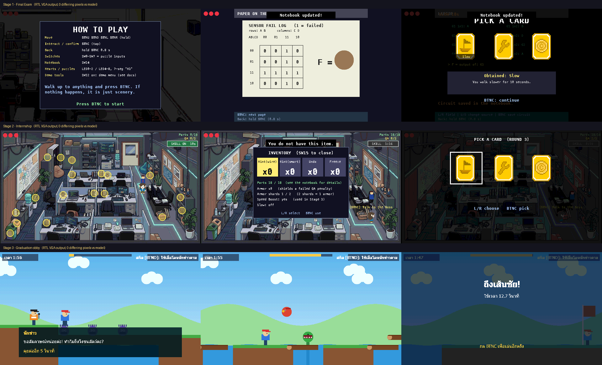

# Digi of Adventure — CPE Escape Room × Obby on FPGA

The Pygame game *CPE Escape Room × Obby*, ported to **synthesizable Verilog** for the
**Digilent Nexys A7-100T** (Vivado). The Pygame demos in `demo_py/` are the reference
("source of truth"); the FPGA version reproduces them tick by tick.



*Frames produced by the simulated Verilog (VGA output pins); each matches the Python model with 0 differing pixels.*

| Stage | Game | Status |
|---|---|---|
| 1 | Final Exam escape room: puzzles, cards, hearts, door | ported, matches Pygame tick by tick |
| 2 | Internship: find 18 parts, wire a 7-segment decoder, QA with the Boss | ported, matches Pygame tick by tick |
| 3 | Graduation obby: side-scrolling run over water, animals, reporter, Thai text | ported, matches Pygame within 2 mm (integer physics) |

**Verified in simulation only** (Icarus Verilog + Python). Vivado synthesis / timing / bitstream and a
board test have **not** been run yet. Details: [`fpga/docs/VERIFICATION.md`](fpga/docs/VERIFICATION.md).

## Quick guide

**Requirements:** Icarus Verilog, Python 3 with `pygame`, `Pillow`, `numpy`. For the board: Vivado + Nexys A7-100T.

```bash
# run all simulation checks (about 15-20 min; without "quick" the VGA frame checks are included, 1 h+)
cd fpga && ./run_tests.sh quick

# create the Vivado project (add "build" to also synthesize and write the bitstream)
vivado -mode batch -source fpga/vivado/create_project.tcl -tclargs 100t

# play the original Pygame demos
python3 demo_py/stage1_demo.py
```

**Board controls:** BTNU/D/L/R move · BTNC interact / confirm (hold 0.8 s = back) · SW0–SW7 puzzle inputs ·
SW12 demo menu (jump to checkpoints / stages) · SW14 notebook · SW15 inventory.
Stage 3: BTNL/BTNR run, BTNU or BTNC jump, BTND skill.

**Notes:** Block RAM is close to full (≈ 132 of 135, estimate) — the Nexys A7-50T is too small.

**Docs:** [`ARCHITECTURE.md`](fpga/docs/ARCHITECTURE.md) (how it works) · [`STATUS.md`](fpga/docs/STATUS.md)
(decisions, differences from Pygame) · [`VERIFICATION.md`](fpga/docs/VERIFICATION.md) (what was tested).

---

## ภาษาไทย

โปรเจกต์นี้คือการแปลงเกม Pygame *CPE Escape Room × Obby* ให้เป็น **Verilog ที่สังเคราะห์ได้จริง**
สำหรับบอร์ด **Digilent Nexys A7-100T** (ใช้ Vivado) โดยยึดเกม Pygame ในโฟลเดอร์ `demo_py/` เป็นต้นแบบ
และทำให้ทำงานเหมือนกันทุกเฟรม

| ด่าน | เนื้อหา | สถานะ |
|---|---|---|
| 1 | ห้องสอบปลายภาค: ปริศนา การ์ด หัวใจ ประตู | แปลงครบ ผลตรงกับ Pygame ทุกเฟรม |
| 2 | ฝึกงาน: หาชิ้นส่วน 18 ชิ้น ต่อวงจรถอดรหัส 7-segment ส่ง QA ให้หัวหน้า | แปลงครบ ผลตรงกับ Pygame ทุกเฟรม |
| 3 | รับปริญญา (obby): วิ่งข้ามน้ำ หลบสัตว์ หนีนักข่าว ข้อความภาษาไทย | แปลงครบ ตำแหน่งต่างจาก Pygame ไม่เกิน 2 มม. (ฟิสิกส์แบบจำนวนเต็ม) |

**ตรวจสอบด้วยการจำลอง (simulation) เท่านั้น** ยังไม่ได้รัน Vivado (synthesis / timing / bitstream)
และยังไม่ได้ทดสอบบนบอร์ดจริง รายละเอียดอยู่ใน [`fpga/docs/VERIFICATION.md`](fpga/docs/VERIFICATION.md)

### วิธีใช้งานโดยย่อ

**สิ่งที่ต้องมี:** Icarus Verilog, Python 3 พร้อม `pygame` `Pillow` `numpy` และถ้าจะลงบอร์ด: Vivado + Nexys A7-100T

```bash
# รันชุดทดสอบทั้งหมด (ประมาณ 15-20 นาที ถ้าไม่ใส่ quick จะรวมการตรวจภาพ VGA ด้วย ใช้เวลา 1 ชม.ขึ้นไป)
cd fpga && ./run_tests.sh quick

# สร้างโปรเจกต์ Vivado (ใส่ build ต่อท้ายเพื่อสังเคราะห์และสร้าง bitstream)
vivado -mode batch -source fpga/vivado/create_project.tcl -tclargs 100t

# เล่นเกม Pygame ต้นฉบับ
python3 demo_py/stage1_demo.py
```

**การควบคุมบนบอร์ด:** BTNU/D/L/R เดิน · BTNC โต้ตอบ / ยืนยัน (กดค้าง 0.8 วิ = ย้อนกลับ) · SW0–SW7 ใส่คำตอบปริศนา ·
SW12 เมนูเดโม (ข้ามไปเช็กพอยต์ / ด่าน) · SW14 สมุดโน้ต · SW15 กระเป๋าไอเท็ม
ด่าน 3: BTNL/BTNR วิ่ง, BTNU หรือ BTNC กระโดด, BTND ใช้สกิล

**หมายเหตุ:** หน่วยความจำ Block RAM เกือบเต็ม (ประมาณ 132 จาก 135 เป็นค่าประมาณ) บอร์ด Nexys A7-50T เล็กเกินไป
